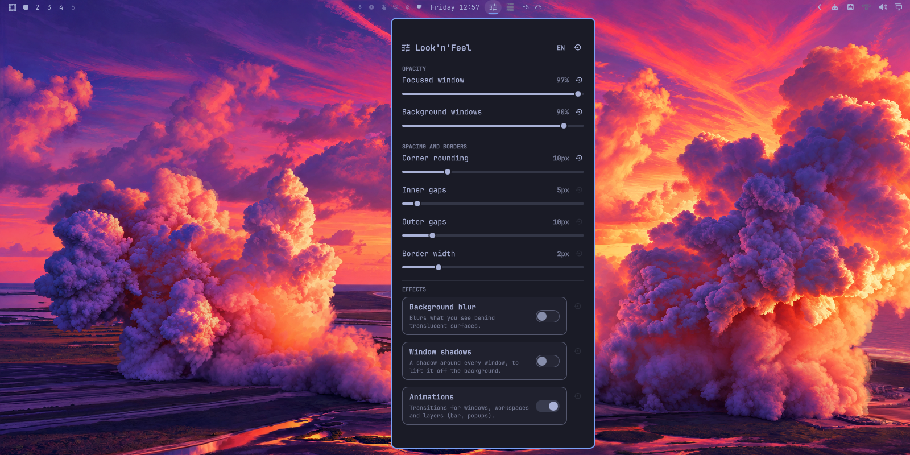

# Look'n'Feel — tune Hyprland's look'n'feel from the Omarchy bar

[](https://github.com/meperdev/omarchy-looknfeel/actions/workflows/ci.yml)

One bar icon that opens a panel with Hyprland's window appearance: opacity for the
focused window and the ones behind, corner rounding, inner/outer gaps, border
width, and switches for background blur, window shadows and animations.

It ships as an **Omarchy plugin** (`bar-widget`), so it installs with
`omarchy plugin add`, updates with `omarchy plugin update`, and its settings live
in the Omarchy settings UI. It applies to the **running session as you drag** and
persists into a managed block of `~/.config/hypr/looknfeel.lua`, so your tuning
survives a reload or a reboot.



## Install

```
omarchy plugin add https://github.com/meperdev/omarchy-looknfeel.git --enable
```

The widget lands on the right of the bar (move it with `omarchy bar move`), and
`omarchy-restart-shell` is enough to pick up local edits.

Requirements: Omarchy with Hyprland's Lua config (Quattro / 4.x) — the live path
uses `hl.config()` through Hyprland's IPC socket. Sound is optional and needs
`QtMultimedia` in the shell; without it the panel stays silent, it still works.

## Controls

| Control | Hyprland option | Range | Omarchy default |
|---|---|---|---|
| Focused window | `decoration:active_opacity` | 10–100 % | 100 % |
| Background windows | `decoration:inactive_opacity` | 10–100 % | 100 % |
| Corner rounding | `decoration:rounding` | 0–40 px | 0 px |
| Inner gaps | `general:gaps_in` | 0–60 px | 5 px |
| Outer gaps | `general:gaps_out` | 0–60 px | 10 px |
| Border width | `general:border_size` | 0–10 px | 2 px |
| Background blur | `decoration:blur:enabled` | on/off | off |
| Window shadows | `decoration:shadow:enabled` | on/off | off |
| Animations | `animations:enabled` | on/off | on |

- **Every row has its own reset** (the ⟲ on the right), lit only while that value
  differs from Omarchy's default. The header's ⟲ resets all nine values and drops
  the managed block.
- Dragging previews on the running session; releasing persists.
- If you close the panel in the middle of a drag, the last previewed value is
  persisted anyway — the session and the config file never drift apart.
- **English or Spanish**: the `EN`/`ES` button in the panel header switches the
  whole panel (no restart), and `looknfeel lang es` does the same from a
  terminal. English is the default.

## How it works

- **UI is data-driven.** `looknfeel read` returns the live values *and* per-option
  metadata (kind, Lua path, Omarchy default); the rows come from two models with
  `Repeater`, so adding a control is adding a row.
- **Live apply without processes.** Changes go straight to Hyprland's IPC socket
  (`$XDG_RUNTIME_DIR/hypr/$HYPRLAND_INSTANCE_SIGNATURE/.socket.sock`) from inside
  the shell. Hyprland closes the connection after each command, so the channel
  reconnects per command and always sends the *latest* requested value instead of
  queuing — that is what makes dragging feel continuous. If the socket is not
  available it falls back to the CLI with a 50 ms throttle.
  - Note: `hyprctl keyword` does not work on this Hyprland (its Lua parser answers
    *«keyword can't work with non-legacy parsers. Use eval.»* and does nothing);
    the live path is `eval 'hl.config({...})'`.
- **Persistence** is a managed block at the end of `~/.config/hypr/looknfeel.lua`,
  between `-- >>> looknfeel (managed) >>>` and `-- <<< looknfeel (managed) <<<`.
  `looknfeel.lua` loads after Omarchy's defaults, so it wins. Deleting the whole
  block is the config-level reset.
- **Sound**: a short click (22 ms, `assets/click.wav`) on switches, on any reset
  and when a slider is released — never while dragging. It loads through a
  `Loader` (`QtMultimedia`), so a shell without that module loses the sound, not
  the panel. Turn it off in the widget settings or with
  `omarchy bar set meperdonas.looknfeel sound false`.
- **Language**: every user-visible string lives in `i18n.js` (`en` and `es`), and
  the panel reads the active one from `~/.config/looknfeel/lang` (one line, `en`
  or `es`, English when the file does not exist). The header button and
  `looknfeel lang` write that same file; the manifest and the README are always
  English, since that is what the catalog publishes.

## CLI

The widget is a thin UI over the CLI that ships inside the plugin:

```
looknfeel read                 live values + metadata, as JSON
looknfeel live <key> <value>   apply to the running session, no persist
looknfeel set  <key> <value>   apply and persist
looknfeel reset                Omarchy defaults, drops the managed block
looknfeel lang [en|es]         widget language (no argument: prints it)
```

Keys: `focused` `unfocused` `rounding` `gapsIn` `gapsOut` `border` `blur`
`shadows` `animations`. `LOOKNFEEL_CONFIG` points it at another config file (used
by the tests).

## Settings

- **Sound** — UI click on/off.
- **Icon** — any Nerd Font glyph for the bar icon (default md-tune
  `U+F062E`; md-window_restore `U+F05B2` and md-palette `U+F03D8` also fit):

  ```
  omarchy bar set meperdonas.looknfeel icon $'\U000f05b2'
  ```

- **looknfeel command** — empty uses the CLI that ships in the plugin; set it
  only to point somewhere else.

## Uninstall / reset

```
omarchy plugin disable meperdonas.looknfeel     # or: omarchy plugin remove meperdonas.looknfeel
```

Removing the plugin leaves your tuned values applied to the session until the next
reload; to go back to Omarchy's defaults, run `looknfeel reset` first (or delete
the managed block from `looknfeel.lua`).

## License

MIT.
